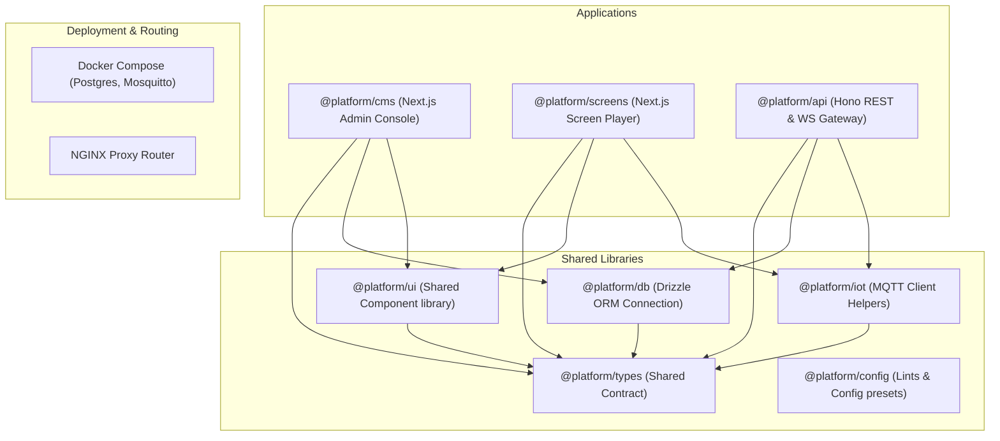

# Event-Driven Digital Signage, CMS, and IoT Platform

Welcome to the Experience Center Digital Signage and Content Management Platform. This is a production-grade monorepo setup powered by **pnpm**, **Turborepo**, and **TypeScript**.

## Key Features

- **Template / experience system** — content is authored as *experiences* backed by
  code-defined templates (`portfolio`, `live-stream`). Each experience stores its own content
  in Postgres (`experience.templateContent`) and is edited in a full-screen CMS editor with a
  live preview.
- **Real-time CMS ↔ screen sync** — assigning content in the CMS pushes it to the matching
  display over a WebSocket in milliseconds; touch interactions on a screen reflect back into
  the CMS. No polling.
- **Live Stream template** — a publisher (e.g. a Unity/AR-glasses app) pushes video frames
  over the WebSocket gateway; screens decode them in real time (WebCodecs H.264 / MJPEG) and
  show the live feed. One `streamId` per experience.
- **Multi-screen** — every display is an independent screen (its own assigned content + its own
  URL `…/screens/<screenId>`), managed from the CMS.
- **Media library, auth, IoT** — media uploads, role-based admin auth (better-auth), and an
  MQTT gateway for device telemetry.

## Architecture & System Topology

The platform integrates three main applications:
1. **CMS** (`@platform/cms`): Next.js admin console for experiences/templates, media, screen
   management, and live device status.
2. **Screen Player** (`@platform/screens`): Next.js renderer per display; subscribes over
   WebSocket and renders the assigned experience/template (incl. live streams) full-screen.
3. **API + Gateway** (`@platform/api`): Hono REST API, the WebSocket hub (per-screen rooms,
   content broadcast, live-stream relay), and the MQTT device gateway.



## Repository Structure

```
├── apps/
│   ├── api/             # Hono Backend, WebSocket & MQTT entry point
│   ├── cms/             # Next.js Admin CMS Dashboard
│   └── screens/         # Next.js Screen Player
├── packages/
│   ├── config/          # Shared eslint and tsconfigs
│   ├── db/              # Drizzle ORM setup location
│   ├── iot/             # MQTT helpers and event normalizers
│   ├── types/           # Shared TypeScript types
│   └── ui/              # Shared UI components
├── infra/
│   ├── docker/          # Compose stacks
│   ├── mosquitto/       # Mosquitto configs
│   ├── nginx/           # Routing and gateway configurations
│   └── scripts/         # Setup scripts
├── package.json         # Workspace root package manifest
├── turbo.json           # Turborepo orchestration config
├── pnpm-workspace.yaml  # Pnpm workspaces schema
└── tsconfig.base.json   # Root base typescript rules
```

## Running the Setup

### Prerequisites
- Node.js v20+
- pnpm v9 (`corepack enable` — the repo pins `pnpm@9.0.0`)
- Docker & Docker Compose

### Get Started
1. Run `pnpm install` in the root of the project to bootstrap all package dependencies.
2. Create your environmental variables: `cp .env.example .env`.
3. Spin up the infrastructure components: `docker compose -f infra/docker/docker-compose.yml up -d`.
4. Run all services in development mode: `pnpm dev`.
5. Build all packages and applications: `pnpm build`.

In dev the apps run directly: CMS `http://localhost:3000`, Screens `http://localhost:3001`
(a screen is at `http://localhost:3001/<screenId>`), API `http://localhost:4000`.

## Production Deployment (office LAN)

The whole stack runs as Docker containers on one host (e.g. `192.168.1.250`); **only Nginx is
published, on port 80**. Everyone on the LAN uses one shared instance — no per-device installs.

```powershell
pnpm infra:build      # build the api/cms/screens images
pnpm infra:up         # start the full stack (postgres, mosquitto, api, cms, screens, nginx)
# after recreating app containers, refresh nginx so it re-resolves their IPs:
docker restart cms-nginx
pnpm healthcheck      # http://localhost/health → all "ok"
```

URLs (replace the IP with your host):

| Purpose | URL |
|---|---|
| CMS admin | `http://192.168.1.250/` |
| A screen / TV | `http://192.168.1.250/screens/<screenId>` |
| Live-stream publisher endpoint | `ws://192.168.1.250/ws/` |
| Health | `http://192.168.1.250/health` |

The frontends use **relative** `/api` and `/ws` paths resolved from `window.location`, and the
screens app is served under `/screens` (Next.js `basePath`), so one build serves every device.
See [`.doc/infrastructure.md`](./.doc/infrastructure.md) and
[`.doc/networking.md`](./.doc/networking.md) for the full deployment + routing details.

## Team / Contributor Setup (shared host database)

If a host machine on your LAN is already running the platform (its Postgres holds
the shared data), you can develop against it **without installing or seeding your
own database**. You run the apps locally; only the database lives on the host.

**Prerequisites:** Node 20+, pnpm 9+ (`corepack enable`), and the host's LAN IP +
DB password (ask the host owner — the password is *not* stored in this repo).

```bash
# 1. Clone
git clone https://github.com/vamsi80/cms-platform.git
cd cms-platform

# 2. Create the three env files from the templates
cp .env.team.example          .env
cp apps/cms/.env.example       apps/cms/.env
cp apps/screens/.env.example   apps/screens/.env.local

# 3. Edit ONLY the root .env:
#    - set <HOST_IP>      → e.g. 192.168.1.250
#    - set <DB_PASSWORD>  → the password from the host owner
#    (apps/cms/.env: generate your own BETTER_AUTH_SECRET via `openssl rand -hex 32`)

# 4. Install and run
pnpm install
pnpm dev          # → http://localhost:3000  (CMS),  http://localhost:3001  (Screens)
```

Notes:
- The root `.env` is the single source of `DATABASE_URL` — `@platform/db` loads it
  automatically, so the per-app env files don't repeat the DB connection.
- **Do NOT run** `pnpm db:migrate`, `db:push`, or any seed script — the host owns
  the schema and shared data.
- MQTT is optional in dev; the host doesn't publish the broker on the LAN, so
  IoT/MQTT features stay "unavailable" locally unless you run your own broker.
- **Host owner**, for teammates to reach the DB, open the firewall for Postgres on
  the host (Administrator PowerShell):
  ```powershell
  New-NetFirewallRule -DisplayName "CMS Platform Postgres" -Direction Inbound -Protocol TCP -LocalPort 5432 -Action Allow
  ```
