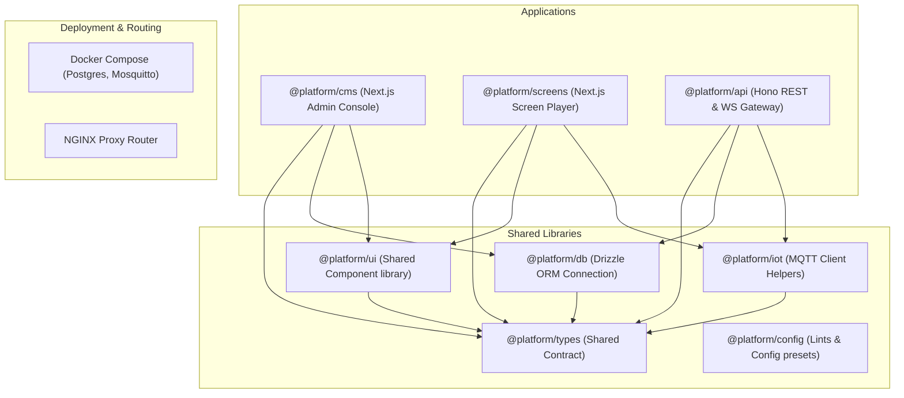

# Event-Driven Digital Signage, CMS, and IoT Platform

Welcome to the Experience Center Digital Signage and Content Management Platform. This is a production-grade monorepo setup powered by **pnpm**, **Turborepo**, and **TypeScript**.

## Architecture & System Topology

The platform integrates three main core domains:
1. **CMS**: React-based admin control panel for content curation, scheduling, and live device telemetry viewing.
2. **Screen Player**: Edge device renderer that reads playlists/templates and plays scheduled dynamic content.
3. **IoT and Messaging Gateway**: High-throughput message broker processing sensor events, evaluating edge rules, and publishing layout adjustments.



## Repository Structure

```
├── apps/
│   ├── api/             # Hono Backend, WebSocket & MQTT entry point
│   ├── cms/             # Next.js Admin CMS Dashboard
│   └── screens/         # Next.js Screen Player
├── packages/
│   ├── config/          # Shared eslint and tsconfigs
│   ├── db/              # Drizzle ORM setup location
│   ├── iot/             # MQTT helpers and event normalizers
│   ├── types/           # Shared TypeScript types
│   └── ui/              # Shared UI components
├── infra/
│   ├── docker/          # Compose stacks
│   ├── mosquitto/       # Mosquitto configs
│   ├── nginx/           # Routing and gateway configurations
│   └── scripts/         # Setup scripts
├── package.json         # Workspace root package manifest
├── turbo.json           # Turborepo orchestration config
├── pnpm-workspace.yaml  # Pnpm workspaces schema
└── tsconfig.base.json   # Root base typescript rules
```

## Running the Setup

### Prerequisites
- Node.js v20+
- pnpm v11+
- Docker & Docker Compose

### Get Started
1. Run `pnpm install` in the root of the project to bootstrap all package dependencies.
2. Create your environmental variables: `cp .env.example .env`.
3. Spin up the infrastructure components: `docker compose -f infra/docker/docker-compose.yml up -d`.
4. Run all services in development mode: `pnpm dev`.
5. Build all packages and applications: `pnpm build`.
