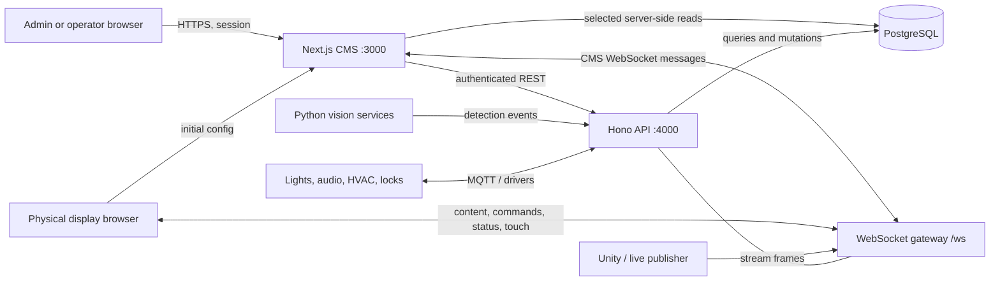
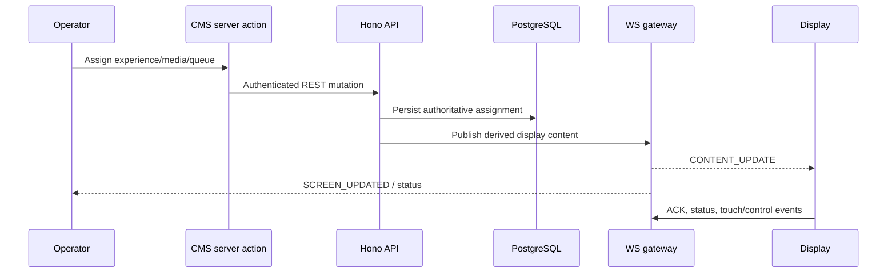
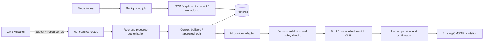

# CMS Platform: System Overview and AI Integration Guide

> Code-based review of the repository as of 9 September 2026. This document focuses on `apps/cms`, while following its dependencies into `apps/api`, `packages/db`, shared UI/types, and the vision services where that is necessary to explain the complete system.

## Executive summary

This project is not a traditional website CMS. It is an **experience-centre control platform** that combines:

- content authoring and a media library;
- digital-signage playback on independently addressable screens;
- real-time remote control and synchronized screen updates;
- interactive, code-defined experiences;
- live video, browser, document, whiteboard, and presentation tools;
- product and portfolio catalogues;
- visitor recognition and product/object detection;
- controls for room equipment such as lights, audio, climate/IR devices, and door locks.

The CMS solves the operational problem of controlling content, screens, visitor-facing experiences, and physical-room systems from one authenticated browser interface. PostgreSQL is the durable source of truth. A Hono API owns most mutations and a WebSocket gateway pushes state changes to displays immediately. MQTT and device-specific drivers connect the platform to physical equipment. Separate Python vision services already supply machine-learning inference.

The best first AI integrations are **authoring assistance, media understanding/search, and operational diagnostics**. They fit existing workflows, can remain human-reviewed, and do not put AI directly in the critical screen-control path. Autonomous screen changes and biometric personalization should come later, with explicit rules, audit trails, consent, and deterministic fallbacks.

## 1. What the CMS is

The CMS is the administrator and operator-facing Next.js application in `apps/cms`. It also contains the public display player served at `/display/[screenId]`; therefore the same application provides both the control plane and much of the screen-rendering surface.

There are three useful ways to think about it:

1. **Authoring plane** — administrators create experiences, select code-defined templates, edit template data, manage products/portfolio entries, upload media, and save whiteboards.
2. **Control plane** — operators assign content to screens, push queues, blank/resume screens, control playback, monitor status, and operate the room environment.
3. **Presentation plane** — each physical screen opens a stable public URL, loads its current configuration, maintains a WebSocket connection, and renders whatever the control plane assigns.

It is designed primarily for an on-premise experience centre or showroom rather than public multi-tenant SaaS. The deployment notes assume a trusted office LAN, local Nginx, local Postgres/Mosquitto, kiosk displays, and optional local inference hardware.

## 2. What it solves

### Content fragmentation

Operators do not need separate tools for videos, images, documents, product demos, live streams, browser pages, or custom interactive experiences. These can be managed and pushed from one interface.

### Slow or manual screen updates

An assignment is persisted and broadcast over WebSocket. A connected display changes without polling, a reload, or a person walking to the screen.

### Multi-screen coordination

Each screen has a stable natural identifier, its own display URL, current assignment, optional media queue, fallback media, whiteboard state, and blackout state. Screens can consequently be controlled independently while sharing a common backend.

### Reusable interactive experiences

Content and rendering logic are separated. A template is implemented in code, while each experience stores its own editable JSON content. The same renderer is used for preview and display, reducing preview/display drift.

### Bridging digital content and the physical room

The device layer provides a stable representation for lights, scenes, speakers, cameras, IR-controlled equipment, and other devices. Drivers then translate the stable API into MQTT or vendor-specific operations.

### Context-aware interactions

The existing vision systems recognize returning visitors and detect physical products. The gateway can translate detection events into content changes, including the object-recognition experience.

## 3. Major user-facing modules

| Module                 | Purpose                                                                           | Primary code area                                                       |
| ---------------------- | --------------------------------------------------------------------------------- | ----------------------------------------------------------------------- |
| Dashboard              | Operational summary, screen state, uptime, storage/media metrics, activity        | `src/app/(dashboard)/page.tsx` and dashboard components                 |
| Experiences            | Group, tag, configure, preview, edit, and run interactive experiences             | `src/app/(dashboard)/experiences`, `src/app/edit`, `src/templates`      |
| Screens                | Register screens, assign content, mirror/control them, set defaults, blank/resume | `src/app/(dashboard)/screens`, `src/actions/screen-actions.ts`          |
| Broadcast              | Select media and publish it to one or more screens                                | `src/app/(dashboard)/broadcast`                                         |
| Media                  | Upload/link assets, preview them, consume email-ingested media, push queues       | `src/app/(dashboard)/media`, API media routes                           |
| Products               | Maintain product details, features, specifications, and associated media          | `src/app/(dashboard)/products`                                          |
| Whiteboards            | Create multi-page drawings and live-push synchronized strokes to screens          | `src/app/(dashboard)/whiteboards`, whiteboard protocol/sync modules     |
| Visitors               | Review camera-recognized people/photos, add identity data, merge duplicates       | `src/app/(dashboard)/visitors`                                          |
| Environment            | Operate lighting, audio, climate, IR remotes, and security/door controls          | `src/app/(dashboard)/environment`, environment actions                  |
| Browser and live tools | Open web content and provide a focused live control view per device               | `src/app/(dashboard)/browser`, `broadcast/live`, experience live routes |
| Display player         | Public kiosk surface that renders assigned content and receives live commands     | `src/app/display`                                                       |
| Administration         | Users, roles, experience types, and settings                                      | `src/app/(dashboard)/users`, `settings`                                 |

The repository also includes embedded help pages under `src/app/docs` for operator workflows.

## 4. Core domain model

### Screen

A screen represents a physical display and uses `screenId` as its natural primary key. Its record keeps:

- the current content kind (`experience` or `media`);
- the assigned experience or media asset;
- an optional ordered media queue and index;
- default/fallback media;
- persisted whiteboard and blanked/blackout state;
- position and timestamps.

The display does not need to understand media queues. The backend advances the queue and updates the ordinary current-media field, keeping the display contract simple.

### Experience

An experience is a named, ordered, soft-deletable unit of interactive content. It has:

- a unique slug;
- an optional `templateKey`;
- `templateContent`, a JSON object keyed by template key;
- creator/updater attribution;
- optional types/tags through the experience-type relation.

Content remains stored for every previously used template. Switching a template therefore does not erase earlier work.

### Template

Templates are **code-defined**, not user-created page schemas. A template definition supplies a key, label, renderer (`Layout`), default content, and optionally an editor (`Workspace`). The current registry contains:

- portfolio;
- live stream;
- product showcase;
- welcome;
- object recognition;
- flight simulation;
- gallery.

Object recognition intentionally has no editor because camera inventory events supply its live content. Adding a fundamentally new presentation normally requires code changes to the template registry, shared content types/defaults, renderer, and usually an editor workspace.

### Media asset

A media asset records a public URL, type, name, size, source, uploader, and optional thumbnail. Sources include direct upload, pasted link, and email attachment. Pending browser links can be pushed before an operator chooses to retain them in the library.

### Product and portfolio data

Products have structured features, specifications, and media. Portfolio content has verticals, categories, companies, projects, images, videos, and settings. These relational structures support the product-showcase and portfolio presentation experiences.

### Visitor

A visitor is intentionally separate from an authenticated CMS user. It stores identity fields, timestamps, face images, and a 512-dimensional ArcFace embedding indexed by pgvector for cosine matching. It may later be linked to a real user. This is sensitive biometric data and requires stronger governance than ordinary CMS data.

### Device

A device is a stable abstraction over physical equipment. Its type, status, last-known state, and driver-specific configuration allow the API to address heterogeneous hardware through a consistent contract.

### Whiteboard

Saved whiteboard documents contain pages; live screen state is also persisted on the screen. A custom protocol synchronizes drawing commands and surfaces between operator and display.

## 5. How it works

### High-level topology

Nginx is the production entry point. Authenticated administration is HTTPS; display and public media routes are deliberately available without a CMS session so kiosk devices can render them.

### Content authoring flow

1. An administrator creates or selects an experience.
2. They choose a registered template.
3. The editor route loads the corresponding template `Workspace` and the saved content for that template key.
4. Edits are rendered in a live preview.
5. Saving calls a server action, which calls the Hono experience API.
6. The API validates and merges the content into `experience.templateContent` without destroying other template keys.
7. Next.js revalidates affected pages.

Portfolio is a special case because its richer relational tree is fetched from dedicated tables rather than living entirely in the experience JSON.

### Screen assignment and live-update flow

On startup, `/display/[screenId]` resolves the screen configuration. If nothing is assigned it still starts the live player and keeps its WebSocket connected, so the first assignment appears immediately. The renderer switches on a discriminated content type: video, image, HTML, generic stream, or experience. Experience rendering then switches on the template key.

Blackout and whiteboard state are persisted, not only relayed in memory. A display that reconnects after a network or power interruption therefore resumes the intended operational state.

### Live-stream flow

An external publisher identifies a stream and sends encoded frames to the WebSocket gateway. Displays showing the matching live-stream experience receive those frames and decode/render them. The gateway is a relay; normal experience data stores the stream identifier and presentation settings.

### Vision-triggered flow

There are two related Python ML areas:

- `services/vision`: face detection/recognition, visitor presence, ArcFace embeddings, and product/object detection;
- `services/product-vision`: a local CUDA YOLO inference service and camera client focused on product detection.

Vision workers send internal events to the API. The API/gateway applies confidence and routing rules, updates screen-facing content, and notifies connected clients. The object-recognition template is explicitly driven by mat-camera inventory updates. This is already AI/ML integration, although it is narrow computer vision rather than a general-purpose language-model feature.

### Environment-control flow

CMS server actions call device, light, audio, IR, and door APIs. The backend selects a configured driver and communicates through MQTT, Home Assistant, Casambi, Tuya/IR, or another adapter. Device state and events return through the backend to the CMS.

## 6. Application and package boundaries

| Area                      | Responsibility                                                                                   |
| ------------------------- | ------------------------------------------------------------------------------------------------ |
| `apps/cms`                | Next.js UI, server components/actions, template editors, preview, public display player          |
| `apps/api`                | REST API, validation, mutations, WebSocket hub, broadcast logic, ingestion, device orchestration |
| `packages/db`             | Drizzle schemas and data-access functions for Postgres                                           |
| `packages/types`          | Shared transport/domain types and validation contracts                                           |
| `packages/ui`             | Shared components and experience renderers/default content                                       |
| `packages/iot`            | MQTT helpers and normalized device events                                                        |
| `packages/vision-browser` | Browser-side capture/stability/transport helpers                                                 |
| `services/vision`         | Face/visitor and object recognition workers                                                      |
| `services/product-vision` | Dedicated local YOLO product-inference server/client                                             |
| `infra`                   | Docker, Nginx, Mosquitto, certificates, and deployment scripts                                   |

Current code follows a pragmatic hybrid access pattern: CMS server-side reads sometimes import `@platform/db` directly, while most mutations use authenticated Hono endpoints. Any new AI feature should avoid adding a third, inconsistent access path.

## 7. Authentication, authorization, and public boundaries

- Better Auth provides sessions.
- Middleware performs a lightweight cookie-presence redirect.
- Pages, server actions, and API middleware perform authoritative session/role checks.
- Admins can perform configuration and destructive operations.
- Guest/operator access is allowed for selected screen-control operations.
- Display, media, WebSocket, health, and selected preview routes bypass the CMS login redirect by design.
- Internal machine events use service-side routes/secrets rather than a browser session.

For AI, treat authorization as part of every feature: retrieval must filter before data reaches a model, tools must re-check roles server-side, and model output must never be considered authorization.

## 8. Existing intelligent/automated capabilities

It is important not to duplicate what is already present:

| Capability                                    | Present implementation                                              | Nature                                                      |
| --------------------------------------------- | ------------------------------------------------------------------- | ----------------------------------------------------------- |
| Face detection and returning-visitor matching | ArcFace embeddings plus pgvector nearest-neighbour lookup           | ML/computer vision                                          |
| Physical product/object recognition           | Trained YOLO models, confidence/stability controls, local inference | ML/computer vision                                          |
| Detection-driven screen takeover              | API/gateway rules translate detection into content                  | Deterministic orchestration around ML                       |
| Media thumbnail generation                    | Sharp-based backend processing                                      | Deterministic automation                                    |
| Email attachment ingestion                    | Gmail ingestion service into media assets                           | Deterministic automation                                    |
| Content and screen sync                       | WebSocket event protocol                                            | Real-time automation, not AI                                |
| Flight generation/catalogue logic             | API flight services and a flight-simulation template                | Domain automation; inspect before labeling as generative AI |

No general LLM/provider SDK is visible in the reviewed CMS/API dependency manifests. Language-based authoring, semantic retrieval, summarization, and an operator copilot therefore appear to be new capabilities rather than hidden existing ones.

## 9. Best places to integrate AI

### Priority 1: AI-assisted experience authoring

Add a “Draft with AI” action inside template workspaces. The user supplies a short brief, audience, tone, and available assets/products. The backend returns **schema-valid draft content** for the selected template.

Good first examples:

- welcome-screen headline, supporting text, and call to action;
- product feature and specification summaries;
- gallery captions and ordering suggestions;
- portfolio project summaries and category descriptions;
- translation or tone variants of existing content.

Why it fits: every template already has a content contract, defaults, editor, and preview. AI can propose JSON that goes through the same editor and save path. Keep save/publish as a separate human action.

Implementation boundary:

- UI trigger in each `Workspace`, preferably backed by a reusable authoring panel;
- `POST /api/ai/draft-template` in `apps/api`;
- Zod schema selected by `templateKey` from shared types/UI;
- model output parsed and validated, then returned as a draft;
- existing `updateExperienceTemplateContent` remains the only save mechanism.

Do not let the model emit arbitrary JSX/HTML or directly write `templateContent`.

### Priority 2: Media enrichment and semantic search

Generate metadata after upload or email ingestion:

- image description and tags;
- OCR text for images/documents;
- transcript, chapter boundaries, and summary for video/audio;
- dominant subjects/brands/products;
- safety or quality-review flags;
- a text/image embedding for semantic search.

Operators could then ask “find the short product video with the red glasses” rather than remembering a filename.

Implementation boundary:

- enqueue enrichment after the existing upload/link/email-ingest path;
- run it in a background worker, never block uploads;
- store derived metadata separately from the source asset;
- use pgvector, which is already part of the database deployment, for embeddings;
- expose semantic search as an optional mode in the current media picker/library.

### Priority 3: Product and portfolio content assistant

Use existing structured product and portfolio data as grounded context to:

- normalize imported specifications;
- draft short/long descriptions;
- identify incomplete records;
- suggest product-to-media links;
- create customer-specific comparison narratives;
- generate a product-showcase draft from selected products.

This has a lower hallucination risk than open-ended generation because the source facts already live in Postgres. The UI should show citations back to the exact product fields/media used and forbid invented specifications.

### Priority 4: Operations copilot and diagnostics

Add a read-only assistant for questions such as:

- “Which screens have been offline today?”
- “What is currently on the lobby screen?”
- “Why is screen 3 black?”
- “Show media uploaded from email this morning.”
- “Which device errors started after the last content push?”

This should call narrowly scoped server-side tools that return structured results. Start read-only. Later, propose commands such as assigning content or recalling a lighting scene, but require a visible confirmation that lists the exact targets and action.

Inputs can include screen status samples, content-push history, device state, and relevant logs. This may expose observability gaps: the current database has screen status and push/event records, but robust diagnosis will benefit from normalized error events and correlation IDs.

### Priority 5: Natural-language experience composition

Once authoring assistance is reliable, allow: “Create a 60-second visitor journey: welcome, three product slides, then the portfolio gallery.” The model should compile the request into a constrained **experience plan/DSL**, not executable code. A deterministic renderer validates and previews that plan before saving.

This likely needs a new composite/playlist template and explicit duration/transition schemas. It should not dynamically generate React components in production.

### Priority 6: Privacy-aware visitor personalization

The platform already detects visitors, so a policy engine could choose language, accessibility settings, or staff/guest content. Use deterministic attributes and consented profile data first. An LLM may generate wording, but must not infer sensitive traits from a face or camera image.

Safer examples:

- greet a known, opted-in visitor by their saved name;
- select a preferred language explicitly stored in their profile;
- summarize previously selected interests;
- alert staff that a returning visitor arrived.

Avoid emotion detection, demographic inference, personality scoring, or consequential decisions from biometric data.

### Priority 7: Vision operations improvements

Improve the existing ML lifecycle rather than adding another overlapping detector:

- surface confidence distributions and false-positive review;
- create a human labeling/review queue;
- identify model drift by camera/location/time;
- version models and correlate detections with deployed weights;
- use approved detections to suggest training samples;
- consolidate the overlap between `services/vision` object inference and `services/product-vision`.

This is high operational value but requires dataset and model-operations discipline, not an LLM-first solution.

## 10. Recommended AI architecture

### Recommended components

1. **Provider-neutral AI package/service** — define interfaces for text generation, vision captioning, transcription, and embeddings. This keeps local and cloud deployments interchangeable.
2. **Hono AI routes** — centralize auth, rate limits, validation, audit, and secrets in `apps/api`; never expose provider keys through `NEXT_PUBLIC_*` variables.
3. **Template schemas** — share strict input/output schemas. The model returns data, not rendered code.
4. **Context builders** — retrieve only the products, portfolio records, media metadata, or operational state authorized for the request.
5. **Background jobs** — use a durable queue for upload enrichment, transcription, bulk embeddings, and retries. An in-process promise is not sufficient for production.
6. **AI run/audit storage** — record feature, user, model/provider, prompt-template version, source resource IDs, status, latency, token/cost data, safety result, and accepted/rejected outcome. Store full prompts/responses only when policy allows.
7. **Human approval boundary** — drafts can populate editors; existing mutations perform final saves and screen actions after confirmation.

### Suggested data additions

Keep derived data distinct from canonical content. Possible tables:

- `media_asset_enrichment`: asset, status, caption, OCR/transcript, tags, embedding, model/version, timestamps;
- `ai_run`: requester, feature, provider/model, prompt version, resource references, status, usage, latency, error, timestamps;
- `ai_feedback`: run, accepted/rejected, optional edited result/diff and reason;
- `operational_event`: normalized screen/device/content/error event with correlation ID;
- `visitor_consent`: purpose, scope, source, granted/revoked timestamps and retention policy.

Do not mix generated metadata into the original media name/URL fields, and do not overwrite human-authored template content before approval.

## 11. Cloud versus local models

The deployment is LAN-oriented and contains biometric and camera data, so use a hybrid policy:

| Workload                                 | Recommended default                                                                       |
| ---------------------------------------- | ----------------------------------------------------------------------------------------- |
| Face matching and live product detection | Existing local models                                                                     |
| Raw camera frames and visitor face crops | Local only; do not send to a general cloud model by default                               |
| Public marketing copy generation         | Cloud or local, configurable                                                              |
| Product/portfolio grounded drafting      | Cloud or local after field-level data classification                                      |
| Media embeddings/captions                | Local for sensitive/internal assets; configurable cloud for approved assets               |
| Operational copilot                      | Prefer a model deployment compatible with infrastructure/log confidentiality requirements |

The provider adapter should enforce per-feature routing. “Local mode” must be a real supported configuration with predictable degradation—not a checkbox added after cloud-specific code is embedded throughout the CMS.

## 12. Guardrails and failure handling

- **Validate every generated object** against a strict schema and size limits.
- **Ground factual copy** in selected product/portfolio records and show sources.
- **Separate propose from execute** for screen, device, user, and deletion actions.
- **Re-authorize every tool call** in the API; never trust IDs or roles supplied by the model/client.
- **Use idempotency keys** for confirmed operational actions.
- **Preserve deterministic fallback content** when AI or network services are unavailable.
- **Set timeouts and circuit breakers** so inference cannot stall display/control endpoints.
- **Rate-limit by user and feature** and cap model/tool iterations.
- **Redact secrets and minimize personal data** before prompts are logged or sent externally.
- **Define biometric consent and retention** before visitor personalization expands.
- **Audit model/version and input resource IDs** so an output can be reproduced or investigated.
- **Evaluate with task-specific datasets** rather than judging a feature from a few demos.
- **Never place generative inference in the frame-by-frame display path.** Displays should receive already validated content or deterministic commands.

## 13. Phased roadmap

### Phase 0 — foundations

- Inventory data classifications and decide which content may leave the LAN.
- Choose local/cloud provider strategy and create the provider-neutral interface.
- Add `ai_run`, prompt versioning, structured logs, budgets/rate limits, and feature flags.
- Extract or confirm Zod schemas for every template AI is allowed to draft.
- Define a small offline evaluation set and acceptance metrics.

Exit condition: a server-side test endpoint can generate and validate a draft without saving it, leaking credentials, or affecting a display.

### Phase 1 — low-risk user value

- Add draft/rewrite/translate actions to Welcome, Product Showcase, Gallery, and Portfolio editors.
- Add human preview, diff, accept/reject, and feedback capture.
- Add media caption/tag/OCR enrichment for newly uploaded images and documents.
- Add semantic media search behind a feature flag.

Success measures: time to complete an experience, draft acceptance/edit distance, search success rate, latency, failure rate, and cost per accepted result.

### Phase 2 — grounded intelligence

- Generate product/portfolio narratives strictly from selected records.
- Add transcript/chapter support for video.
- Build the read-only operations copilot with a fixed tool allow-list.
- Normalize operational events and correlation IDs for better diagnosis.

Success measures: factual precision, cited-field coverage, diagnostic accuracy, and reduction in time to identify screen/device issues.

### Phase 3 — controlled actions and composition

- Introduce the constrained composite-experience plan/DSL.
- Let the copilot propose screen/device actions with exact-target confirmation.
- Add dry-run previews, idempotency, rollback where possible, and detailed audit logs.

Success measure: safe completion rate with zero unconfirmed state-changing actions.

### Phase 4 — carefully governed personalization and MLOps

- Add explicit visitor consent/preferences and deterministic personalization rules.
- Add detection review, drift monitoring, labeling workflow, and model registry/version visibility.
- Consolidate or clearly divide the two product/object-vision implementations.

## 14. A practical first vertical slice

The strongest first experiment is **“Draft a Product Showcase”**:

1. Operator chooses one or more existing products.
2. They enter audience, tone, maximum length, and goal.
3. The API loads only those product records and approved media metadata.
4. The model returns a `ProductShowcaseContent` draft using a strict schema.
5. The CMS opens the normal editor with a diff/preview.
6. The operator edits and accepts it.
7. The existing experience save action persists it.
8. Publishing to a screen remains the existing, separate operator action.

This exercise establishes the reusable provider adapter, grounding, schema validation, auditing, human approval, and evaluation loop without touching live operational behavior.

## 15. Important technical observations

- Existing `structure.md` files are useful orientation but lag current implementation in places. The current repository has seven templates and many modules absent from the older short overview.
- CMS reads and API ownership are not completely clean-cut: some CMS server actions/components import DB functions for reads, while mutations generally call the API. Standardize the new AI boundary through the API.
- The CMS and display player share an application. AI dependencies should remain server-only so they do not increase kiosk bundles or expose secrets.
- Public display/media routes are intentional. AI-generated private drafts or enrichment artifacts must not inherit those public URLs accidentally.
- JSON template content makes experimentation quick, but schema versioning/migrations become important once AI generates it at scale.
- The platform already has pgvector through visitors, making semantic media retrieval feasible, but media embeddings should use a separate column/table and matching index appropriate to their dimension/model.
- The current source tree suggests both direct vision and dedicated product-vision approaches. Clarify ownership before investing in new object models.
- Dashboard sample-data components exist; verify which displayed analytics are production-backed before using them to ground an operations assistant.

## 16. Key code references

- CMS template registry: `apps/cms/src/templates/definitions.ts`
- Template keys/labels: `apps/cms/src/lib/templates.ts`
- Experience mutations: `apps/cms/src/actions/experience-actions.ts`
- Screen control mutations: `apps/cms/src/actions/screen-actions.ts`
- Display entry point: `apps/cms/src/app/display/[screenId]/page.tsx`
- Display content dispatch: `apps/cms/src/app/display/_components/ContentRenderer.tsx`
- Live display client: `apps/cms/src/app/display/_components/LiveScreenPlayer.tsx`
- CMS/screen synchronization: `apps/cms/src/hooks/useCmsScreenSync.ts`, `useScreenWebSocket.ts`
- API route composition: `apps/api/src/index.ts`
- WebSocket gateway and detection routing: `apps/api/src/ws/gateway.ts`
- Screen/experience/media schemas: `packages/db/src/schema/screens.ts`, `projects.ts`, `media.ts`
- Visitor biometric schema: `packages/db/src/schema/visitors.ts`
- Device abstraction: `packages/db/src/schema/devices.ts`
- Vision services: `services/vision`, `services/product-vision`

## Bottom line

The CMS is a real-time experience orchestration platform with a solid separation between durable state, event delivery, and rendering. AI should enter first as a **reviewable assistant around existing contracts**—drafting structured template content, enriching/searching media, and explaining operational state. It should not replace the database, bypass the API, generate runtime UI code, or directly control displays/devices without confirmation. That approach delivers value quickly while preserving the deterministic behavior an experience-centre control system needs.
